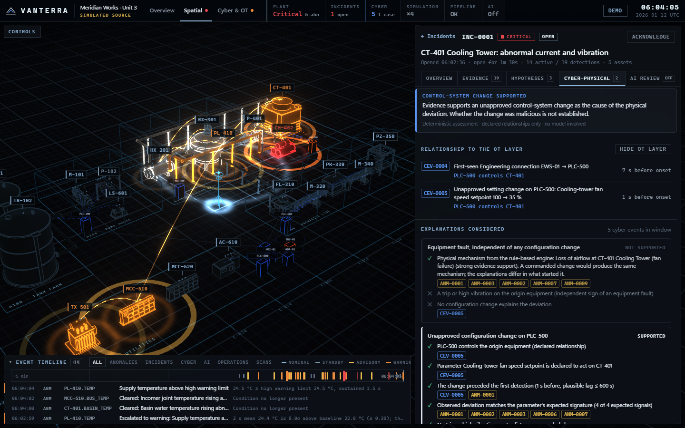
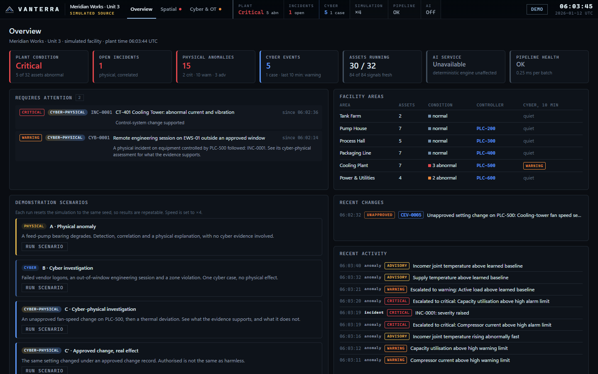
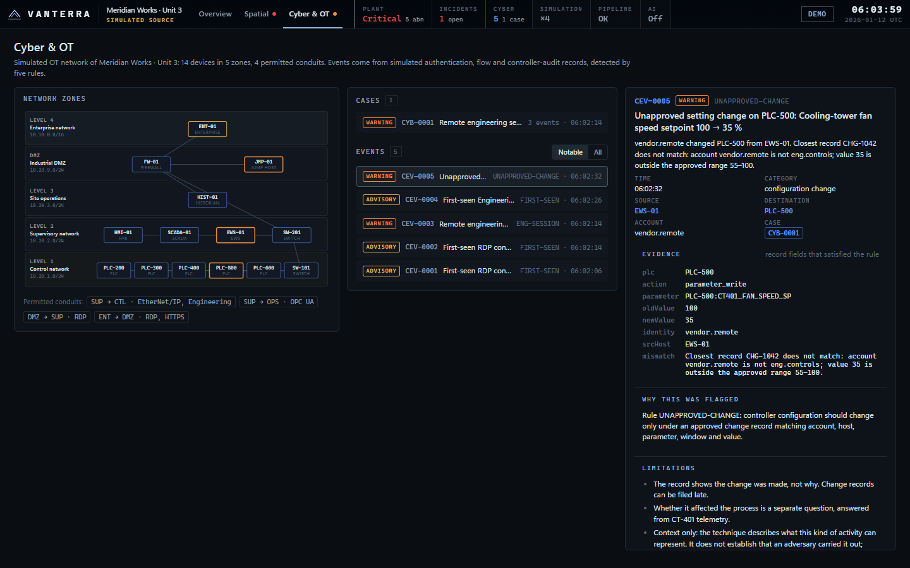
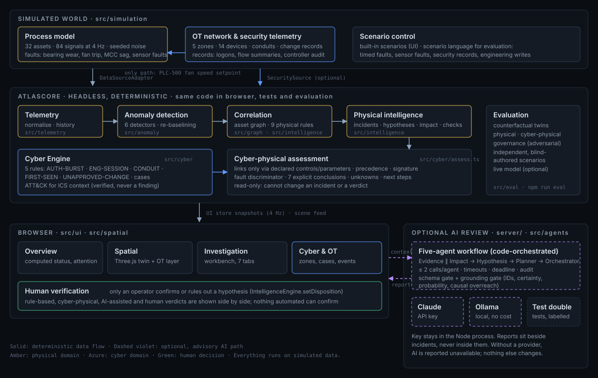
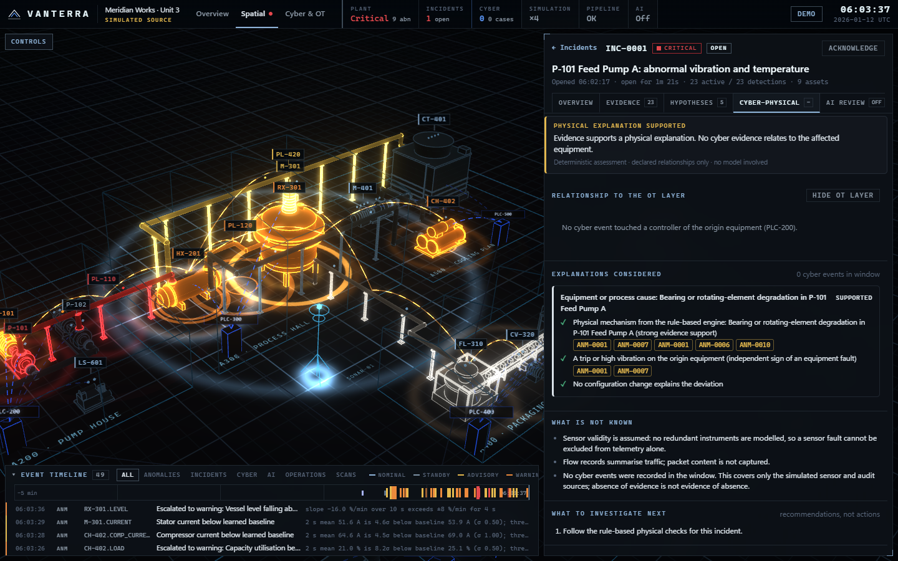

# Vanterra — Cyber-Physical Intelligence

**Investigate the physical and the digital together.** Vanterra watches an industrial plant's process telemetry *and* its OT network. It detects abnormal behaviour in both, links events only through declared equipment and control relationships, and builds an evidence-backed investigation: what is happening, what changed, which explanations the evidence supports, what it does not support, and what a person should check next.



▶ **[Watch the 82-second demo](docs/demo/vanterra-demo.webm)**: a real screen capture of the product running the flagship scenario, with captions. `npm run record-demo` regenerates it.

> **Simulated, and honest about it.** The plant (32 assets, 84 signals) and its OT network (14 devices, 5 zones) are simulations. The detection, correlation, cyber-physical assessment, agent workflow and validation that act on that data are real code. Nothing connects to or controls real equipment or networks. [docs/SIMULATED_VS_REAL.md](docs/SIMULATED_VS_REAL.md) draws the line.

> **AI status.** The optional five-agent LLM review runs on either the Claude API or a **local model through Ollama, with no API key and no cost** ([docs/LOCAL_AI.md](docs/LOCAL_AI.md)). The local path has been **run for real** with `qwen3:4b` on a CPU-only 16 GB laptop: real agent calls inside real investigations, through the same validation gates, which rejected and repaired real model answers ([EVALUATION.md §4](EVALUATION.md#4-live-language-model)). On that hardware it is slow (19–45 min per agent call). The Claude provider has not been run against the live API (no key). The deterministic investigation, including the full cyber-physical assessment, needs no model at all.

## Contents

[Why](#why-cyber-physical) · [Quick start](#quick-start) · [Product tour](#product-tour) · [Flagship scenario](#flagship-scenario) · [Architecture](#architecture) · [Cyber layer](#the-cyber-layer) · [Cyber-physical assessment](#the-cyber-physical-assessment) · [AI review](#ai-review) · [Evaluation](#evaluation) · [Testing](#testing) · [Configuration](#configuration) · [Layout](#project-layout) · [Limitations](#limitations) · [Docs](#further-documentation)

## Why cyber-physical

A pump overheats. Was it a worn bearing, an operator setpoint change, a vendor's maintenance session, or someone who should not have been on the engineering workstation? Physical monitoring sees the symptom. OT security monitoring sees the session. Each, looked at alone, invites the wrong conclusion: blaming hardware for a configuration change, or blaming an attacker for a worn bearing.

Vanterra puts both in one investigation, under rules of evidence:

- A cyber event relates to a physical incident **only through a declared relationship**: the controller it touched controls the equipment where the incident started. Time alone is never a link.
- A configuration change can explain a physical deviation **only if it came first, within a plausible lag, and the deviation matches** what that parameter is declared to move.
- Independent signs of an equipment fault (a trip, high vibration) **keep the physical explanation open**.
- Every conclusion lists **what is not known**, and none of them claims intent.

The possible conclusions are explicit: *physical explanation supported* · *control-system change supported* · *approved change supported* · *possible relationship, insufficient evidence* · *correlated, causality not established* · *multiple explanations plausible* · *insufficient evidence*.

## Quick start

**Windows desktop app.** Vanterra runs as a desktop application with its own window, Start Menu entry and uninstaller. It runs no local web server and opens no port, and it needs no configuration. To build the installer (Node.js 20+ required to build, not to run):

```bash
npm install
```

```bash
npm run desktop:dist
```

This produces `release/Vanterra-Setup-0.4.0.exe`. The installer is per-user and needs no administrator rights. It is **not code-signed**, so Windows SmartScreen shows a warning on first run (*More info → Run anyway*). `npm run desktop` runs the app without installing it.

For the AI features, install [Ollama](https://ollama.com) and run `ollama pull qwen3:1.7b` once. The app finds Ollama and starts it if it is not running. Without Ollama, everything except the AI works. How the desktop app is built: [docs/DESKTOP_ARCHITECTURE.md](docs/DESKTOP_ARCHITECTURE.md).

**In a browser (development).** On Windows, double-click `start-vanterra.cmd`; on any platform:

```bash
npm install
```

```bash
npm run dev
```

Open http://localhost:5173 in a WebGL2 browser. Everything works offline with no configuration. Keys `1` `2` `3` switch between Overview, Spatial and Cyber & OT.

| Command | What it does |
| --- | --- |
| `npm run desktop:dist` | Build the Windows installer into `release/` |
| `npm run desktop` | Build and run the desktop app without installing |
| `node scripts/smoke-desktop.mjs` | Launch the packaged app and check UI, AI service, Ask, 3D and console errors |
| `npm run dev` | Development server (with the AI service) |
| `npm test` | 164 unit, scenario, cyber, agent, provider, desktop-bridge and accessibility tests |
| `npm run eval` | Offline evaluation over 10 seeds → `eval/results/` |
| `npm run eval:live` | Live-model evaluation with a real model (local Ollama or Claude) |
| `npm run build` | Type-check and build a static bundle (no AI service) |
| `npm run capture` | Regenerate `docs/screenshots/` from the running app |
| `npm run record-demo` | Record the captioned demo video from the running app |
| `npm run check` | Type-check, lint and test |

## Product tour

| Area | What it answers |
| --- | --- |
| **Overview** | Is the facility normal? What needs attention, in which domain (physical, cyber, cyber-physical)? What changed? One-click demonstration scenarios. Every figure is computed; there are no illustrative risk scores. |
| **Spatial** | The plant in 3D: assets by health, sonar-style scan, dependency and OT layers (controllers, control links to the machines they drive, network links). An incident focuses the scene on what is involved. |
| **Investigation workbench** | Overview with rule-based, AI-assisted, human and cyber-physical verdicts side by side; evidence chain; hypotheses with evidence for and against; **cyber-physical assessment**; AI review; impact; recommended checks; acknowledge and confirm/rule out. |
| **Cyber & OT** | The OT network by Purdue level, permitted conduits, cyber cases, the event feed, and full event detail: evidence fields, why it was flagged, limitations, ATT&CK for ICS context, and the physical equipment within reach. |





## Flagship scenario

**C · Unapproved fan-speed change** (Overview → *Run scenario*, or the welcome card):

1. A vendor account logs on to the jump host, then remotely to the engineering workstation, outside any approved window. *(ENG-SESSION, warning)*
2. The workstation opens a first-seen engineering connection to PLC-500, the cooling-plant controller. *(FIRST-SEEN, advisory)*
3. PLC-500's cooling-tower fan speed setpoint is written 100 % → 35 %. Change record CHG-1042 covers this parameter, but for a different account and a range of 55–100 %. *(UNAPPROVED-CHANGE, warning; ATT&CK context T0836 Modify Parameter)*
4. The process responds: fan current falls, basin temperature and chiller load rise, and the physical engine opens a critical incident at CT-401 from measurements alone.
5. The assessment links the change to the incident through *PLC-500 controls CT-401*, notes that it came first (≈ 1 s before the first detection), that 4 of 4 expected signals moved as declared, and that no trip or high vibration contradicts it. **Conclusion: control-system change supported. Whether it was malicious is not established.**

Three contrast cases show that the platform does not simply blame cyber:

- **A**, a pump bearing fault, gives *physical explanation supported*.
- **A + B**, the same fault with unrelated suspicious access to a *different* controller, gives *correlated, causality not established*.
- **C′**, the same setpoint change made under its approved change record, gives *approved change supported*. Authorised is not the same as harmless.

## Architecture



The same flow, as text:

```
            ┌──────────────── simulation (the "world") ────────────────┐
            │ process model ── fan speed setpoint ◀── controller writes │
            │ 84 signals @ 4 Hz        OT security records (auth, flows,│
            │                           controller audit)               │
            └──────────┬──────────────────────────────┬────────────────┘
                       │ DataSourceAdapter            │ SecuritySource (optional)
 ┌─────────────────────▼──────────────────────────────▼──────── AtlasCore (headless) ┐
 │ Telemetry → Anomaly detection → Asset graph & correlation → Intelligence (incidents,│
 │            (6 detectors)        (physical rules)             hypotheses, impact)   │
 │                                         Cyber Engine (5 rules, cases)              │
 │                         Cyber-physical assessment (declared relationships only)    │
 └───────────────┬───────────────────────────────────────────────┬────────────────────┘
                 │ browser: Overview · Spatial (Three.js) · Workbench · Cyber & OT
                 │                                               │ optional, server side
                 ▼                                               ▼
         human verification  ◀────────────  five-agent AI review (schema + grounding gates)
```

The deterministic core is the source of truth. It runs in the browser, in tests and in the evaluation harness unchanged, and the simulator is behind adapter interfaces. [ARCHITECTURE.md](ARCHITECTURE.md) covers every module.

## The cyber layer

- **OT model** (`src/simulation/otModel.ts`): five zones (enterprise, DMZ, operations, supervisory, control); five PLCs placed in the plant areas they serve; HMI, SCADA, engineering workstation, historian, jump host, firewall and switches. It also declares 4 permitted conduits, 4 role identities, writable parameters with the signals each is expected to move, and approved change records. **Every cyber-physical link is data.**
- **Security telemetry** (`src/simulation/CyberSimulation.ts`): background polling, historian traffic and shift logons, plus three scripted scenarios. These are observations only, and use their own random stream, so physical telemetry is bit-identical with or without them.
- **Cyber Engine** (`src/cyber/CyberEngine.ts`): five detection rules: `AUTH-BURST`, `ENG-SESSION` (outside an approved window), `CONDUIT` (segmentation violation), `FIRST-SEEN` (new communication after a learned baseline), and `UNAPPROVED-CHANGE` (matches no change record on account, host, parameter, window and value). Approved changes and controller reads are recorded as informational. Each event carries evidence fields, rationale and limitations; related events form cases.
- **ATT&CK for ICS context** (`src/cyber/attack.ts`): seven techniques, each ID and tactic checked against attack.mitre.org (content v20.1). They are shown as context, with a standing caveat that a mapping is not a finding.

## The cyber-physical assessment

`src/cyber/assess.ts` evaluates up to four explanations for every incident: equipment fault, unapproved control change, approved change, and unrelated cyber activity. Each has explicit criteria (observed or not, with evidence IDs), a status, unknowns and next steps. It is deterministic and read-only, and it cannot change an incident or a verdict. Only an operator confirms.

**In plain words.** `src/cyber/briefing.ts` restates the same assessment for non-specialists at the top of the Cyber-physical tab. It gives a short summary, a direct answer to *"should this become a cyber investigation?"* (yes, check, separately, no, not yet), what is known for certain, and what the evidence suggests, labelled as interpretation. Every statement keeps its evidence one click away. No model is involved, so it is instant, offline and cannot invent anything. Why this was built, and what was considered instead, is in [docs/PRODUCT_DISCOVERY.md](docs/PRODUCT_DISCOVERY.md).



## AI review

**Ask Vanterra.** Every incident has an **Ask** tab:
- **Quick questions** ("What is going on?", "Should security be involved?", "What do we know for certain?", "What are we guessing?") are answered instantly by the deterministic engine, with no model.
- **Your own questions** go to the configured model. The server then checks the answer before showing it: citations must be real evidence IDs (invented ones are removed), and claims of certainty, odds or intent are rejected unless they are clearly negated. An answer that cites no real evidence is rejected too, after one repair attempt. Rejected drafts are hidden but can be opened for review.
- **Measured with `qwen3:1.7b` on a laptop CPU:** an accepted, cited answer to "Why did the cooling tower readings change, and who changed the fan setting?" in 57 s. The first live runs exposed two checker bugs (decorated citation IDs, a recorded "35%" read as a probability), now fixed with regression tests.

**Run AI agents** in the incident header starts the five-agent review at any time; it can be stopped while running.

Five agents (Evidence, Impact, Hypothesis, Planner, Orchestrator), backed by Claude or by a local Ollama model, review an incident in a code-controlled workflow: at most 2 calls per agent, 90 s per call, 240 s per run. They now receive the cyber events and the deterministic cyber-physical assessment. Every answer passes a strict schema gate and a grounding gate. The grounding gate rejects invented evidence IDs (including CEV IDs), assets and hypotheses, uncited observations, certainty and probability wording, and **causal overreach**, such as "the attacker reduced the fan speed"; hedged, evidence-bounded wording is accepted. AI reports sit beside incidents, never inside them. Without a key the review is shown as unavailable; the scripted test double, used for tests, is always labelled. No paid service is required to use or evaluate the deterministic product.

## Evaluation

Measured over 10 seeds (details, ground truth and caveats in [EVALUATION.md](EVALUATION.md)):

| | Result |
| --- | --- |
| Physical faults: detected, correct origin, correct explanation | 30 / 30 |
| Independent faults kept separate (simultaneous and sequential) | 100 / 100 |
| Physical false positives in 8.5 simulated hours of normal operation | 0 |
| Cyber false positives in 5 simulated hours of normal operation | 0 |
| Cyber scenario B: expected detections fired | 50 / 50 |
| Cyber-physical conclusions correct (6 cases × 10 seeds) | 60 / 60, with 0 wrongly attributed to cyber and 0 cyber causes missed |
| **Independent, blind-authored scenarios** (18 × 5 new seeds) | first run 80 / 90; one product defect found and fixed; now 90 / 90, with 0 false cyber attributions |
| Adversarial model answers reaching an accepted output | 0 / 99 |
| Live-model reasoning quality, latency, cost | **not measured** |

Most scenarios were designed together with the rules. To counter that, a separate agent with no access to the implementation wrote 18 scenarios and their ground truth, covering sensor faults, conflicting evidence, approved work that looks suspicious, and sequential faults. Its first run exposed a real defect: an approved change was masking a later unapproved one. That was fixed and is covered by a regression test. These results show the system behaves as specified on situations it was not tuned to. They do not show performance on real plants or against real adversaries.

## Testing

`npm test` runs 164 tests in 14 files: the physical pipeline per scenario, normal operation, fault separation, operator workflow and reset; the cyber layer (detection, cases, ATT&CK caveats, flagship, approved change, "a cyber event does not establish causality", "a physical anomaly does not imply cyber activity", "a change after onset cannot explain it", "a trip keeps the physical explanation open", read-only assessment, reset repeatability, bit-identical physics, and **no code outside the simulator can write a controller setting**); the agent workflow and grounding (including CEV citations and causal overreach); and the Claude and Ollama providers against local API stubs (for Ollama, including one-at-a-time queueing and slow answers).

## Configuration

Everything is optional; see [.env.example](.env.example). AI review needs either `ATLAS_LLM_PROVIDER=ollama` with a local model ([docs/LOCAL_AI.md](docs/LOCAL_AI.md)) or `ANTHROPIC_API_KEY`, in `.env.local` (read only by the server process). `npm run eval:live` then measures the live model.

## Project layout

```
src/
  simulation/   process model, OT model, security telemetry simulation
  adapters/     data-source contract (telemetry + optional security source)
  telemetry/ anomaly/ graph/ intelligence/   the deterministic physical pipeline
  cyber/        Cyber Engine, ATT&CK context, cyber-physical assessment
  agents/       investigation context, schemas, grounding, five agents, orchestrator
  eval/         evaluation harness (physical, cyber-physical, agents, live)
  runtime/      headless core, browser runtime, AI client
  spatial/      Three.js scene and OT layer
  ui/           Overview, Spatial, workbench, Cyber & OT
server/         AI service, Claude and Ollama providers
docs/           screenshots, brand, demo script, portfolio, publishing
```

## Limitations

- **Simulated plant and OT network.** One facility, three physical faults, three cyber scenarios. Only one controller parameter (the cooling-tower fan speed setpoint) is wired into the process model.
- **Rules, not learned models.** The five cyber rules and the assessment criteria were written alongside the scenarios they are evaluated on.
- **Flow summaries, not packets**; account names, not people. The assessment says so in every conclusion.
- **One incident per asset at a time**, and hypotheses freeze after an operator intervention.
- **Live AI evidence is a small local sample**: one 4B model on one CPU-only laptop, where an investigation takes hours. Claude has not been run live.
- **Not a desktop application yet**: it runs on a local development server and needs Node.js; no persistence. The AI service exists only with `npm run dev` or `npm run preview`. The plan is in [docs/DESKTOP_ARCHITECTURE.md](docs/DESKTOP_ARCHITECTURE.md).
- **The independent scenario author was another AI agent**, separated by information, not a human investigator.
- **No real equipment or network can be reached or controlled**, by design.

## Further documentation

| Document | Contents |
| --- | --- |
| [ARCHITECTURE.md](ARCHITECTURE.md) | Modules, correlation rules, cyber layer, assessment, agents, security |
| [EVALUATION.md](EVALUATION.md) | Methodology, ground truth, results, caveats, what is not measured |
| [docs/SIMULATED_VS_REAL.md](docs/SIMULATED_VS_REAL.md) | Exactly what is simulated and what is real |
| [docs/BRAND.md](docs/BRAND.md) | Name evaluation, identity, colour and terminology |
| [docs/LOCAL_AI.md](docs/LOCAL_AI.md) | Local inference with Ollama: measured performance, fixes, setup |
| [docs/DESKTOP_ARCHITECTURE.md](docs/DESKTOP_ARCHITECTURE.md) | Decision record and plan for a standalone Windows app |
| [docs/PRODUCT_DISCOVERY.md](docs/PRODUCT_DISCOVERY.md) | Who this is for, evidence versus hypotheses, the selected direction and its first proof |
| [SECURITY.md](SECURITY.md) | Security controls, known risks, reporting |
| [eval/independent/](eval/independent/) | Authoring brief, plant catalog and blind-authored scenarios |
| [docs/DEMO_SCRIPT.md](docs/DEMO_SCRIPT.md) | Demo recording package |
| [docs/PORTFOLIO.md](docs/PORTFOLIO.md) | Descriptions, CV text, interview explanation |
| [docs/PUBLISHING.md](docs/PUBLISHING.md) | Steps to publish safely |
| [CONTRIBUTING.md](CONTRIBUTING.md) | Workflow and the rules the code relies on |
| [HANDOVER.md](HANDOVER.md) | Status and roadmap |
