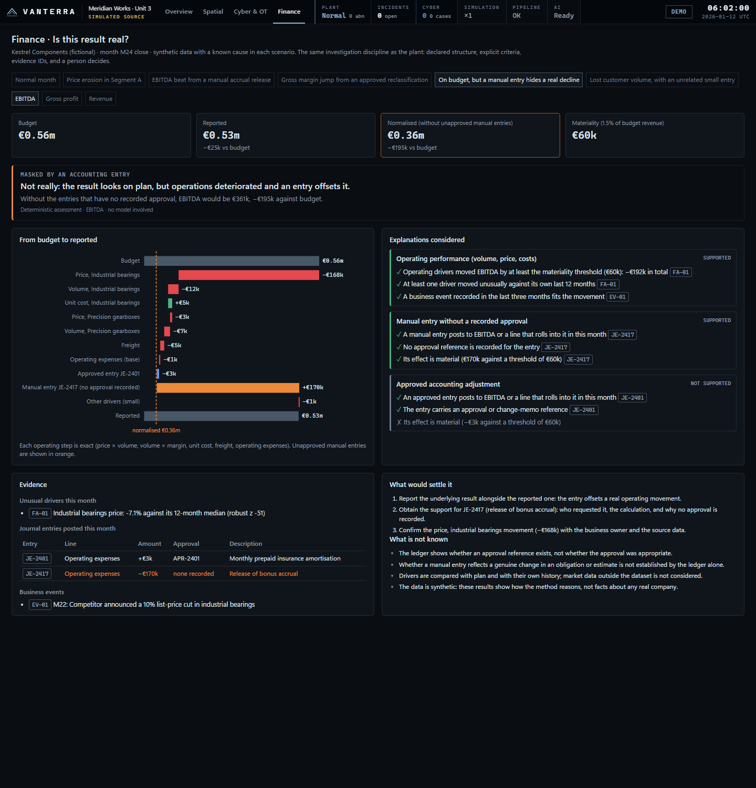

# Beyond industry: finance and consulting

**Date:** 2026-11-21. **Status:** discovery, a decision and a working proof (the **Finance** view, key `4`). Market evidence comes from a small number of web sources, listed at the end; most are vendor material and are treated as directional. No user research was done.

## 1. What Vanterra fundamentally is

Under the plant and the 3D view, Vanterra is an **engine for explaining a measured movement and saying how sure it can be**. It:

1. holds a **declared structure**: what feeds what, and which actor can change which part;
2. detects **unusual movements** against plan and against each quantity's own history;
3. lists **competing explanations**, each with explicit criteria marked observed or not observed, each tied to evidence IDs;
4. links a change to a movement **only through the declared structure**, never through timing alone;
5. **separates what is known from what is inferred**, states what is not known, and never claims intent;
6. keeps a **person in charge**: the AI is checked against the evidence and cannot confirm anything.

Points 3–6 are domain-independent: they are the method. Points 1–2 need a domain model. The industrial code was not refactored to prove this: the finance proof is a separate module (`src/finance/`) that reuses the method, not the code.

## 2. Finance and consulting opportunities examined

| Area | Problem | Fit with the method | Verdict |
| --- | --- | --- | --- |
| **FP&A variance analysis** | Explaining budget vs actual at month end | Driver tree = declared structure; drivers = signals | **Strong** |
| **Transaction services / quality of earnings** | Is EBITDA recurring operating performance or one-off and accounting-driven? | The "control change vs equipment fault" question in finance terms | **Strong** |
| **PE portfolio monitoring** | Is the investment thesis holding in the operating data? | Same engine, monthly | Strong, after the above |
| Audit journal-entry testing | Find risky manual entries (required against management override) | Entries are the "cyber events" | Partial: established vendors score entries; Vanterra's angle is linking entries to the movement they explain |
| Banking operational incidents (DORA) | ICT incident root cause and classification | Very close to the industrial original | Deferred: needs service and log data models (see PRODUCT_DISCOVERY.md §8b) |
| Transformation / PMO monitoring | Why is a programme slipping? | Dependencies fit; evidence is mostly qualitative | Deferred: weak quantitative ground truth |
| Strategy scenario analysis | Choosing between strategic options | Weak: forward-looking judgment, little to "detect" | Rejected for now |
| Fraud detection, trading, investment advice | — | High stakes, regulated, needs real data and expertise | Rejected |

## 3. Market and evidence

**Verified, from the sources below:**

- FP&A teams report spending a minority of their time on analysis: about 22–35 % on high-value work in the FP&A Trends surveys (cited by vendors), and about 25 % in Bain's research. Variance explanation is squeezed at the end of the close.
- Quality-of-earnings work separates recurring operations from one-offs; an add-back should stand only when its nature can be demonstrated, and the analysis should look for missing adjustments, not only challenge proposed ones.
- AI finance tools exist and are moving fast. Datarails offers a chat layer over its data, Planful offers anomaly detection and automated variance analysis with exception reporting, and Pigment is known for driver-based planning. Practitioner guidance says good variance work must investigate drivers, record the evidence behind each explanation, and leave sign-off to a named person.
- Journal-entry testing is a required audit procedure against management override. MindBridge scores entries with combined statistical, rule-based and ML tests; one user review calls the scoring occasionally a "black box".

**Hypotheses, not verified:** analysts lack a tool that ties a specific entry to the specific movement it explains and says "the reported number hides X"; an explicit-criteria approach would be trusted more than a risk score; the "masked decline" pattern (a real deterioration offset by an entry) is common enough to matter.

**Not claimed:** that competitors cannot do this. I found no evidence either way, and the absence of evidence in a few searches is not a market gap.

## 4. Decision: earnings movement investigation

**The strongest opportunity is "Is this result real?":** when EBITDA, margin or revenue moves (or fails to move), determine with evidence whether the cause is operating performance, an accounting entry (approved or not), or both, and show the normalised result.

- **Who:** FP&A analysts and controllers at month end; transaction-services teams doing quality of earnings; PE operating partners monitoring portfolio companies; consultants doing performance diagnostics.
- **Why it is the strongest:** it is the same question Vanterra already answers well ("equipment fault or control change?"), so the method transfers without dilution. It is quantitative, so ground truth can be built and the engine can be tested. It sits where FP&A, due diligence and audit meet. And its flagship case, a decline hidden by an entry, is exactly what an expensive review is meant to find.
- **What makes it different (hypothesis):** not a risk score and not a chat answer, but an explanation that names the entry, the line it posts to, the driver that moved, the criteria met, and the result without it.

## 5. The proof (implemented)

| Part | Where | What it does |
| --- | --- | --- |
| Data | `src/finance/data.ts` | *Kestrel Components* (fictional): 2 segments, 24 months, budget, drivers, a journal ledger with routine approved entries every month, business events. Seeded and deterministic. Six scenarios with a known cause |
| Engine | `src/finance/assess.ts` | Exact bridge from budget to reported (price, volume × margin, unit cost, freight, opex, approved entries, unapproved entries); unusual drivers by robust z-score against 12 months; explanations with criteria and evidence IDs; seven standings including **masked by an entry**; normalised result without unapproved manual entries; unknowns; next steps; plain-language answer |
| View | `src/ui/FinancePage.tsx` | Scenario and line pickers, budget / reported / normalised, the verdict in plain words, the bridge chart, explanations, evidence, what would settle it |
| Tests | `src/finance/finance.test.ts` (12) | Every scenario reaches its ground truth; the bridge sums exactly; every cited ID exists; no intent or certainty wording; read-only; the masked case's normalised result shows the real decline |

| Scenario | Ground truth | Engine |
| --- | --- | --- |
| Normal month | nothing material | ✓ |
| Price erosion in Segment A | operating | ✓ |
| EBITDA beat from a manual accrual release | accounting entry (no approval) | ✓ |
| Gross margin jump from an approved reclassification | approved adjustment (EBITDA unaffected) | ✓ |
| On budget, but a manual entry hides a real decline | masked by an entry | ✓ |
| Lost customer volume, with an unrelated small entry | operating; the small entry is not the cause | ✓ |

The scenarios were written together with the engine, as the first industrial scenarios were. These results show internal consistency, not accuracy on real ledgers.

**Language discipline carried over:** an entry without an approval reference is never called an error, manipulation or fraud. The engine says what the ledger shows (no approval recorded) and what would settle it (obtain the support).

## 6. Architecture implications

- **Keep:** the method (criteria, standings, evidence IDs, unknowns, human decision) and the AI governance (constrained citations, grounding, no confirmation).
- **Add per domain:** a data model and generator, the driver structure, the explanation criteria, the view. About 600 lines here, without touching the industrial code.
- **Do not build yet:** a generic "domain framework". Two domains are not enough to design the right abstraction. A third would be.
- **AI next:** the Ask path transfers directly. The finance evidence catalogue (FA-, JE-, EV- IDs) can be passed as `citableIds`, so the model can only cite real entries and drivers. Not implemented in this proof.

## 7. Limitations

- Synthetic data and a simple chart of accounts; no accruals logic, no balance sheet, no multi-entity consolidation, no FX.
- Materiality is a fixed 1.5 % of budget revenue; real practice varies.
- "Unapproved" means no approval reference in the ledger; it says nothing about whether the entry is right.
- Not validated with practitioners or on real data.

## 8. Validation strategy

1. **Public data:** rebuild the bridge on a public company's segment disclosures (price/volume commentary in annual reports) to test the decomposition on real numbers.
2. **Practitioners:** walk 3–5 FP&A or transaction-services professionals through the six scenarios. Success: they agree with the standings and would use the normalised view.
3. **A real ledger extract** (anonymised, with permission) through a CSV adapter: the first step from proof to tool.

## 9. What to implement next, and what not to

**Next:** CSV import of a trial balance by month and a journal export; AI "Ask" on the finance evidence with constrained citations; a QoE-style schedule of adjustments (reported → normalised, entry by entry) as an export.

**Not:** forecasting, valuation models, investment recommendations, connections to live accounting systems, fraud scoring. Each is a different product, a different risk, or both.

## 10. What this means for Vanterra

Vanterra's identity shifts from *a cyber-physical tool* to *an investigation engine that explains movements with evidence and says how sure it can be*. Industry remains the flagship domain; finance is the second, and the more direct path to the professional roles it is meant to demonstrate.

## Sources

- Bain, *When financial planning and analysis need an overhaul*: https://www.bain.com/it/insights/when-financial-planning-and-analysis-need-an-overhaul/
- FP&A Trends Survey 2021 (slides): https://fr.slideshare.net/JamesMyers5/fpa-trends-survey-2021
- Abacum, budget vs actuals variance analysis: https://www.abacum.ai/blog/how-to-use-budget-vs-actuals-variance-analysis-to-improve-fp-a-outcomes
- Sigma, FP&A reporting: https://www.sigmacomputing.com/blog/fpa-reporting
- Valutico, quality of earnings adjustments: https://valutico.com/quality-of-earnings-qoe-adjustments-a-guide-for-ma-deals/
- TechCrunch, quality of earnings in M&A: https://techcrunch.com/2021/08/10/perform-a-quality-of-earnings-analysis-to-make-the-most-of-ma/
- CFMA, quality of earnings: https://nyc.cfma.org/articles/a-good-deal-quality-of-earnings-are-a-critical-transaction-step
- Tellius, AI variance analysis tools for FP&A: https://www.tellius.com/resources/blog/12-best-ai-variance-analysis-software-tools-for-fp-a-in-2026
- Rework, AI variance analysis and commentary: https://resources.rework.com/libraries/ai-for-finance/ai-variance-analysis
- MindBridge, journal entry testing: https://www.mindbridge.ai/resources/efficient-journal-entry-testing-with-mindbridge-addressing-management-override-risk/
- G2, MindBridge reviews: https://www.g2.com/products/mindbridge/reviews
